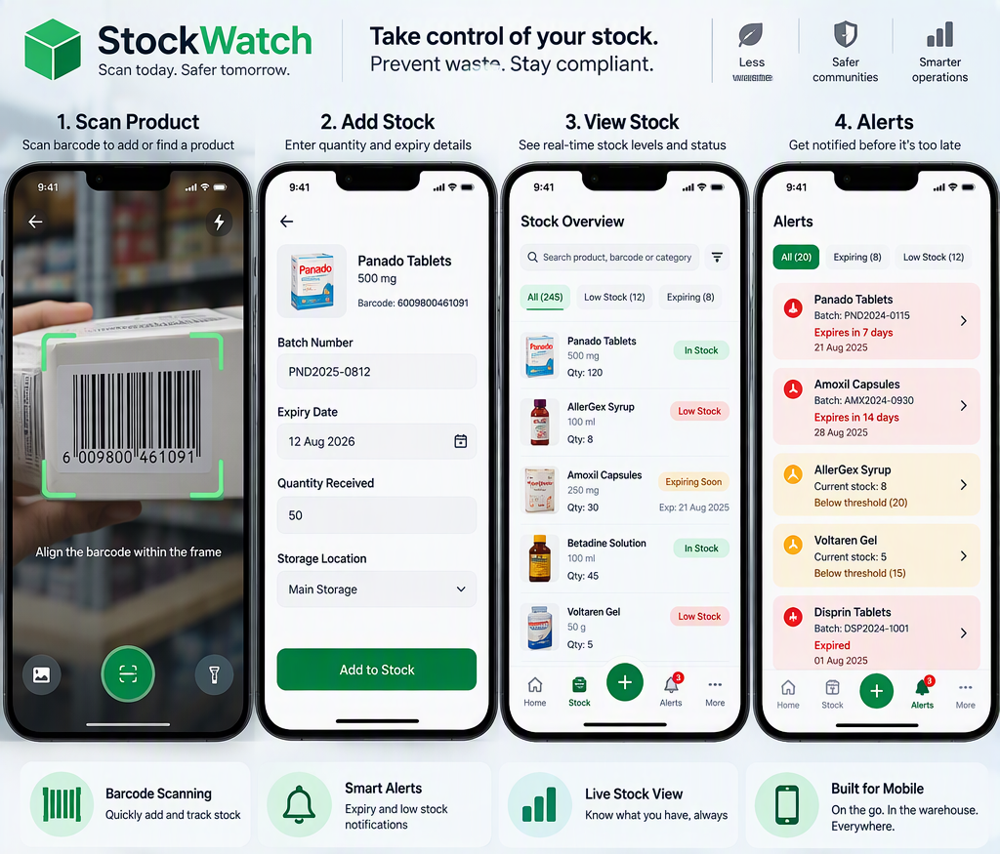

# 📦 StockWatch

A mobile-first **Power Platform** solution for stock and expiry management. StockWatch lets teams scan products in with a barcode, track quantities in real time, and get automatic alerts before stock expires or runs low — replacing manual stock sheets and after-the-fact discoveries with proactive visibility.

## 🧩 The Problem

Businesses that manage physical stock — pharmacies, clinics, retail, warehouses — often lose money and risk compliance issues when:
- Products expire unnoticed because no one is tracking dates in real time.
- Stock runs out before anyone realizes it's low.
- Manual spreadsheets and paper logs catch problems too late to act.

StockWatch closes that gap with barcode-driven data capture and automated daily checks.

## ✨ Key Features

- **Barcode scanning** — scan a product to create it or add a new stock batch in seconds.
- **Batch tracking** — log quantity received and expiry date per batch, not just per product.
- **Live stock overview** — searchable view of every product with status badges: In Stock, Low Stock, Expiring Soon, Expired.
- **Automated expiry alerts** — a daily check flags batches nearing their expiry date before they go to waste.
- **Low stock threshold alerts** — each product has a configurable minimum; falling below it triggers a reorder alert.
- **Reporting dashboard** — stock levels by category, upcoming expiries, and waste trends at a glance.

## 🏗️ Architecture

| Layer | Tool | Purpose |
|---|---|---|
| Mobile app | Power Apps (canvas, barcode scanner control) | Scan products, load stock, view live stock status |
| Data | Dataverse | Stores Products, Stock Batches, Thresholds, and Alerts |
| Automation | Power Automate | Daily flows for expiry checks and low stock checks |
| AI  | AI Builder | Reads expiry dates directly from packaging photos |
| Agent  | Copilot Studio | Conversational queries like "what's expiring this week?" |
| Reporting | Power BI | Stock levels, expiry calendar, waste value, reorder trends |

## 🗃️ Data Model

| Table | Key Fields |
|---|---|
| **Products** | Barcode, Product Name, Category, Minimum Threshold, Unit |
| **Stock Batches** | Product (lookup), Batch No, Quantity, Expiry Date, Date Received |
| **Alerts** | Type (Expiry / Low Stock), Product, Batch, Triggered Date, Status |
| **Audit Log** | Action, User, Timestamp, Before/After Quantity |

## 🔔 How Alerts Work

- **Expiry flow** — runs daily, checks all batches against a configurable expiry window (e.g. 30/14/7 days), creates or updates an Alert, and notifies the stock manager.
- **Low stock flow** — runs daily, sums quantity per product across non-expired batches, and triggers an alert if the total falls below the product's minimum threshold.

## 🚀 Build Roadmap

1. Dataverse tables (Products, Stock Batches, Alerts)
2. Power App — scan & add stock screen
3. Power App — view stock screen with status badges
4. Power Automate — expiry alert flow
5. Power Automate — low stock alert flow
6. Power BI dashboard

## 🛠️ Built With

- Microsoft Power Apps
- Microsoft Dataverse
- Microsoft Power Automate
- Microsoft Power BI

---

*StockWatch — Know what you have. Never lose stock to waste or shortages again.*
# StockWatch
